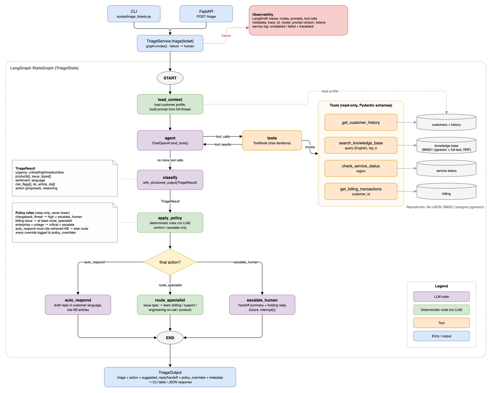

# Support Ticket Triage Agent

Triages one support ticket: urgency, product, issue type, sentiment, KB articles, and the next
action (**auto-respond**, **route to a specialist**, **escalate to a human**). LangGraph +
OpenAI, with deterministic business rules over the model's judgement.
Design, risks and production evaluation: **[WRITEUP.md](WRITEUP.md)**.

## Deliverables

| Brief | Where |
|---|---|
| Terminal console / API | [`scripts/triage_tickets.py`](scripts/triage_tickets.py), [`src/triage/api.py`](src/triage/api.py) |
| Working code on the samples | [Quick start](#quick-start), [Results](#results) |
| System prompt | [`src/triage/prompts/system.md`](src/triage/prompts/system.md) (+ classify, reply and handoff prompts) |
| Tool definitions (schema + mock implementation) | [`src/triage/tools/`](src/triage/tools/README.md): one file per tool, Pydantic input schema + function |
| Write-up | [`WRITEUP.md`](WRITEUP.md) |

## Quick start

Requires Docker with Compose v2.24+.

```bash
cp .env.example .env        # set OPENAI_API_KEY
docker compose build
docker compose run --rm app python scripts/triage_tickets.py data/sample_tickets.json
```

~15–30 s per ticket. Default model `gpt-6-luna`; without access, set `OPENAI_MODEL=gpt-4.1`.

## Results

| Ticket | Urgency | Action | Product / issue | Risk flags | KB |
|---|---|---|---|---|---|
| T-1001 failed upgrade, 3 charges | critical | escalate → billing | analytics / billing | chargeback, duplicate charges, time-sensitive | KB-012, KB-013, KB-001 |
| T-1002 Thai, error 500 for all | critical | escalate → engineering on-call | crm, erp / outage | widespread outage, revenue impact, time-sensitive | KB-031, KB-032, KB-050 |
| T-1003 dark mode questions | low | auto-respond (draft reply) | crm / bug, feature request | - | KB-020 |

Eval on 30 labelled tickets × 3 runs: 100% escalation recall, 100% safe auto-replies, 99%
action accuracy. Reports: [`evals/results/`](evals/results/).

## How it works



1. **load_context**: customer profile + full thread with timestamps.
2. **agent ⇄ tools** (≤ 6 rounds): `get_customer_history`, `search_knowledge_base`,
   `check_service_status`, `get_billing_transactions`. All read-only.
3. **classify**: strict schema (urgency, products, issue types, sentiment, language, risk flags,
   KB ids, action, reasoning).
4. **apply_policy**: rules that only raise urgency or action; overrides are listed in the output.
5. **Action node**: reply draft in the customer's language, team assignment, or handoff summary.

Any failure (timeout, rate limit, invalid output) escalates to a human instead of erroring.

## Scenario and assumptions

The brief gives tickets only; everything else is mock data in [`data/mock/`](data/mock/).

- **Products:** `crm`, `erp`, `analytics` (one account, billing and platform).
- **Plans:** `free`, `pro`, `enterprise` (99.9% SLA, 30-min P1 response). **Regions:** `us`,
  `eu`, `asia`.
- **Service status:** Asia is down while the public status page says operational (T-1002).

| Customer | Plan, region | Products | Notes |
|---|---|---|---|
| C-1001 Jordan Lee | free, us | analytics | 3 pending $29.99 charges (T-1001) |
| C-2001 Somchai Wongsakul (Siam Retail) | enterprise, asia | crm, erp | 45 seats (T-1002) |
| C-3001 Priya Nair | pro, eu | crm | macOS desktop app (T-1003) |
| C-4001 Daniel Kim (Northwind) | enterprise, us | analytics, erp | test set |
| C-5001 Lena Fischer | free, eu | crm | test set |

| Field | Values (own taxonomy, defined in the [system prompt](src/triage/prompts/system.md)) |
|---|---|
| Urgency | `critical`, `high`, `medium`, `low` |
| Issue types | `billing`, `outage`, `bug`, `feature_request`, `usage_question`, `account_access`, `other` |
| Sentiment | `positive`, `neutral`, `negative` |
| Risk flags | `chargeback_threat`, `duplicate_charges`, `time_sensitive`, `revenue_impact`, `widespread_outage` |
| Teams | billing, technical support, engineering on-call, product |

- **Knowledge base:** 12 Markdown articles, some topics left out on purpose
  ([list](data/mock/kb/README.md)).
- T-1003 quotes an earlier agent reply, so that message was added to the thread.
- Replies are drafts; nothing is sent and no tool changes data.

## Usage

```bash
# CLI: one ticket, or JSON output
docker compose run --rm app python scripts/triage_tickets.py data/sample_tickets.json --ticket T-1001
docker compose run --rm app python scripts/triage_tickets.py data/sample_tickets.json --json

# HTTP API (docs at http://localhost:8000/docs)
docker compose up api
curl -X POST localhost:8000/triage -H 'content-type: application/json' -d '{
  "ticket_id": "T-1", "customer_id": "C-3001",
  "messages": [{"sent_at": "2026-11-07T09:00:00Z", "content": "Is there a dark mode?"}]
}'
```

- **Tracing:** set `LANGSMITH_TRACING=true` and `LANGSMITH_API_KEY`. Every output also carries
  trace id, model, prompt version, tokens and latency.
- **Settings:** [`.env.example`](.env.example).

### Backends

| | `file` (default) | `postgres` |
|---|---|---|
| Data | JSON in `data/mock/` | Postgres, seeded from `data/mock/` |
| KB search | BM25 | pgvector + full text, fused with RRF |
| Setup | none | `docker compose run --rm app python scripts/seed_db.py`, then `REPOSITORY_BACKEND=postgres` in `.env` |

Both sit behind the same repository interfaces, so tools, graph and prompts are unchanged. The
eval passes on both ([results](evals/results/)). Re-run the seed after editing `data/mock/`.

## Evaluation

```bash
docker compose run --rm app python scripts/run_eval.py --runs 3 --concurrency 15 --save
docker compose run --rm app python scripts/run_eval.py --backend postgres
```

- 30 tickets: 3 samples + 27 in [`evals/test_set.json`](evals/test_set.json) (KB-answerable
  questions and edge cases); what each covers: [`evals/README.md`](evals/README.md).
- Labels list acceptable values. Metrics: accuracy per field, under-triage, risk-flag
  precision/recall, consistency, policy overrides, fallbacks, latency, tokens.
- Exits 1 if a must-escalate ticket is missed or a reply is automated that should not be.
- `--save` writes an HTML dashboard, Markdown and JSON to `evals/results/`.

## Project layout

```
src/triage/
  service.py      single entry point (CLI, API, eval); fail-safe to a human
  graph/          LangGraph state, nodes, wiring
  prompts/        versioned Markdown prompts
  tools/          the four tools
  policy/         escalation rules + engine
  repositories/   storage interfaces; file (JSON, BM25) and postgres (pgvector) backends
  models/         Pydantic domain models
  evaluation/     scoring and reports
scripts/          triage_tickets.py, run_eval.py, seed_db.py
data/             sample_tickets.json; mock/ = customers, billing, status, KB
evals/            test set, labels, results
tests/            unit tests (fake LLM, no API key) + Postgres integration tests
```

## Extending

- **Rule:** add a function to [`policy/rules.py`](src/triage/policy/rules.py) and list it in `DEFAULT_RULES`.
- **Tool:** add a file to [`tools/`](src/triage/tools/README.md) and register it in `build_tools`.
- **Backend:** implement the protocols in [`repositories/base.py`](src/triage/repositories/base.py), as Postgres does.
- **Eval case:** add a ticket and its label in [`evals/`](evals/README.md).

## Development

```bash
docker compose run --rm app pytest      # starts Postgres for integration tests
docker compose run --rm app ruff check .
```
