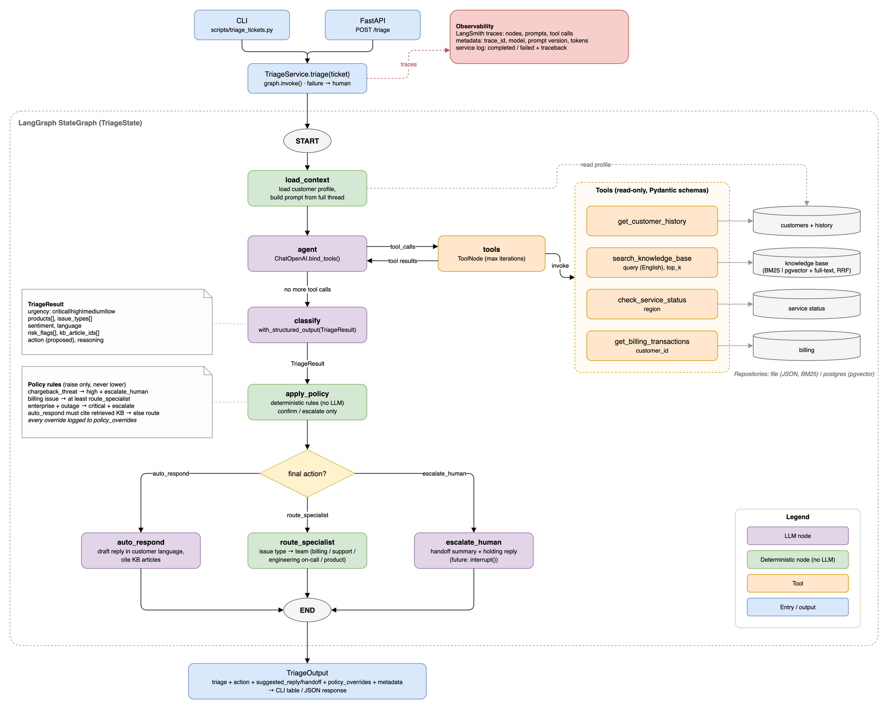

# Write-up

## Overview

1. **Entry:** the CLI and the API both call `TriageService`, which runs the graph and turns any
   failure into an escalation.
2. **load_context** (no LLM): loads the customer profile and renders the whole thread.
3. **agent ⇄ tools** (LLM): calls the four read-only tools until it has enough evidence, at most
   6 rounds. Tools read through repositories: JSON + BM25, or Postgres + pgvector.
4. **classify** (LLM): fills `TriageResult` (urgency, products, issue types, sentiment, risk
   flags, KB ids, proposed action).
5. **apply_policy** (no LLM): rules raise urgency or action where needed and record why.
6. **Action** (diamond): `auto_respond` drafts a grounded reply, `route_specialist` assigns a
   team, `escalate_human` writes a handoff and a holding reply.
7. **Output:** `TriageOutput` with the triage, draft, overrides and run metadata; LangSmith
   traces every step.

## Architecture decisions

| Decision | Why |
|---|---|
| Fixed LangGraph stages; the LLM only chooses tools (≤ 6 rounds) and fills a strict schema | Predictable, testable, bounded cost |
| Deterministic policy after the LLM; rules only raise urgency or action | High-stakes calls (money, chargeback, outage) don't rest on prompt wording. The eval caught a disputed charge auto-answered after a prompt change; a rule now stops it |
| Any failure → escalate with the reason | No ticket is dropped |
| Read-only tools behind repository interfaces | Limits prompt-injection damage; Postgres + pgvector was added without touching tools, graph or prompts |
| Hybrid KB search (vector + full text, RRF); LLM writes queries in English | Finds paraphrases ("money back" → refund policy); Thai and Japanese tickets search an English KB |
| One `TriageService` for CLI, API and eval; LangSmith tracing | One code path; every output has trace id, prompt version, tokens, latency |

## What could go wrong

| Risk | Mitigation | Still open |
|---|---|---|
| Under-triage | Policy floors; escalation recall gate | Risks with no rule |
| Policy misses because the LLM missed a flag | Flags checked against tool data in the prompt | Add signals independent of the LLM |
| Wrong or invented auto-reply | Must cite retrieved KB; drafts only | Reply content not checked against the article |
| Prompt injection, false authority | Ticket treated as data; read-only tools | New phrasings |
| Old account data bleeds in | Classify only what the customer raised | 1 in 3 runs on one ticket |
| Inconsistent decisions | Measured across runs | 83–93% identical over 3 runs |
| LLM outage | Retries, rate limiter, fallback | All tickets go to people |

## Production evaluation

1. **Regression gate:** the 30-ticket eval on every prompt or model change; fails on a missed
   escalation or unsafe auto-reply.
2. **Reply quality:** an LLM judge (a different model) scores drafts for faithfulness to the
   cited KB, no promises or internal IDs, the customer's language, and complete handoffs;
   calibrated against human ratings on a sample first.
3. **Shadow mode:** agent and support team triage the same tickets; audit every case where the
   agent was less urgent.
4. **Gradual rollout:** drafts reviewed by agents; auto-send per issue type once reopen rate and
   CSAT match human replies.
5. **Monitoring:** human override rate, policy override and fallback rates, reopen rate, p95
   latency, cost per ticket, daily urgency/action mix with alerts.
6. **Feedback loop:** every human correction becomes an eval case.
